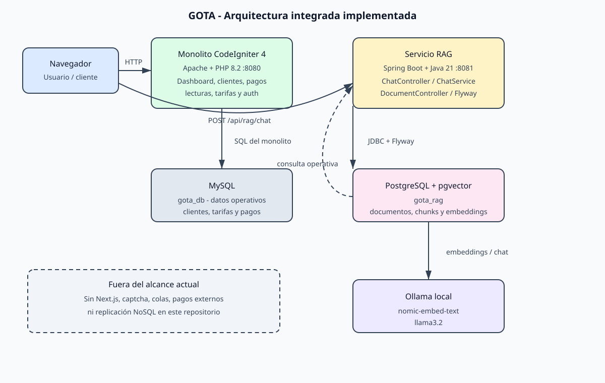
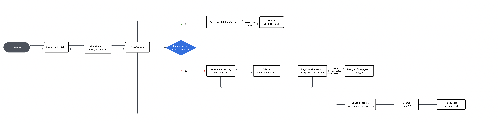
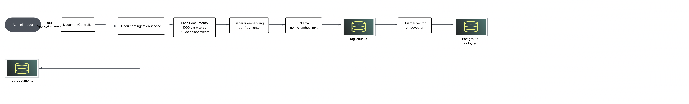

Nombre: Ulises Enríque Pineda Enríquez
Carnet: 0905-23-19852
Repositorio: https://github.com/uenrqz/GOTA_Ulises.git
Modulo asignado: Chatbot con RAG

# GOTA - Arquitectura de la solución integrada

Este repositorio contiene el monolito heredado de GOTA y el microservicio
independiente del chatbot con RAG. La documentación de este archivo se revisó
contra el código fuente, las configuraciones y los archivos de ejecución
presentes en el repositorio.

## Alcance real de esta entrega

El módulo implementado en este repositorio es **Chatbot con RAG**. Actualmente
la solución contiene:

- Un monolito web en CodeIgniter 4, servido por Apache y PHP 8.2.
- Una base de datos MySQL para la operación del monolito.
- Un microservicio Spring Boot 3.4.5 con Java 21 para el chatbot.
- Una base de datos PostgreSQL independiente con `pgvector` para documentos,
  fragmentos y embeddings.
- Ollama local con `nomic-embed-text` para embeddings y `llama3.2` para
  generación de respuestas.

No se encontraron en el repositorio implementaciones de Next.js, captcha,
RabbitMQ/Kafka u otra cola, un servicio de pagos externos ni un servicio de
replicación a NoSQL. Por lo tanto, las otras tres features de la rotación no
se presentan como funcionalidades implementadas:

1. Consulta pública con captcha: no implementada en este repositorio.
2. Chatbot con RAG: implementada en `rag-service/`.
3. Envío de pagos a sistemas externos por colas: no implementado.
4. Replicación asíncrona a NoSQL | SQL: no implementada.

## Arquitectura integrada

El siguiente diagrama se encuentra guardado como
[`docs/architecture.svg`](./docs/architecture.svg) y representa únicamente
componentes y conexiones presentes en el código:



### Componentes y conexiones

- El navegador del usuario accede al monolito CodeIgniter mediante Apache en
  el puerto `8080`. El monolito contiene autenticación, dashboard, clientes,
  contadores, lecturas, tarifas y pagos.
- El monolito consulta su base MySQL `gota_db`.
- El cliente del chatbot llama al endpoint `POST /api/rag/chat` del servicio
  Spring Boot en el puerto `8081`. El README del servicio menciona un BFF de
  Next.js, pero ese BFF no está incluido en este repositorio; por eso no se
  representa como componente desplegable.
- Spring Boot usa PostgreSQL `gota_rag` exclusivamente para el conocimiento
  documental del RAG. Esta base no sustituye ni modifica la base MySQL del
  monolito.
- Spring Boot consulta Ollama local: `/api/embeddings` para crear vectores y
  `/api/chat` para generar la respuesta.
- Para preguntas operativas públicas específicas, el servicio RAG usa una
  conexión separada de solo lectura hacia MySQL y ejecuta consultas SQL fijas.
  El modelo no genera SQL.

## Ejecución de la solución

No existe un `docker-compose.yml` en este repositorio. La ejecución local se
realiza levantando sus dependencias y aplicaciones por separado.

### 1. Monolito CodeIgniter

Requisitos: PHP 8.2+, Composer y MySQL.

```bash
composer install
php spark serve --port 8080
```

El monolito queda disponible en `http://localhost:8080`. La conexión
predeterminada está definida en
[`app/Config/Database.php`](./app/Config/Database.php) y utiliza la base
`gota_db` en MySQL. Para ambientes reales, configura las credenciales fuera del
repositorio mediante el mecanismo de entorno de CodeIgniter.

También existe un [`Dockerfile`](./Dockerfile) para servir el monolito con
Apache en el puerto `8080`, pero no hay una composición Docker que levante toda
la solución.

### 2. PostgreSQL con pgvector

Crea una base llamada `gota_rag` en PostgreSQL, habilita la extensión
`vector` y deja disponible el servidor en el puerto usado por
`RAG_DATABASE_URL` (por defecto `5433`). Flyway crea las tablas al iniciar el
servicio RAG.

### 3. Ollama

Instala Ollama y descarga los modelos requeridos:

```bash
ollama pull nomic-embed-text
ollama pull llama3.2
ollama serve
```

### 4. Servicio RAG

Requisitos: Java 21, Maven 3.9+, PostgreSQL con `pgvector` y Ollama.

```bash
cd rag-service
cp .env.example .env
mvn spring-boot:run
```

Antes de iniciar, revisa los valores de `.env` y reemplaza los valores de
ejemplo por configuración local. No subas ese archivo al repositorio. El
servicio queda disponible en `http://localhost:8081` y su estado se consulta
en `GET /actuator/health`.

## Diagramas detallados del módulo RAG

Los siguientes diagramas fueron incorporados desde el documento de referencia
`RAG GOTA APS RUTAS.pdf` y muestran con mayor detalle los dos flujos
principales del servicio:

### Flujo de consulta del chatbot



Este flujo muestra la decisión entre una consulta operativa controlada y una
consulta documental. En el segundo caso, la pregunta se convierte en embedding,
se recuperan fragmentos mediante `RagChunkRepository`, se construye el prompt
y se genera la respuesta con `llama3.2`.

### Flujo de ingesta documental



Este flujo muestra la recepción administrativa del documento, su división en
fragmentos de 1000 caracteres con solapamiento de 150, la generación de
embeddings con `nomic-embed-text` y el almacenamiento en `rag_documents` y
`rag_chunks` dentro de PostgreSQL.

## Módulo asignado: Chatbot con RAG

### Objetivo y funcionalidad

El módulo permite que el ciudadano formule preguntas sobre procedimientos y
contenido documental de GOTA. El servicio recupera información relevante antes
de pedirle al modelo que redacte una respuesta. Esto reduce respuestas
inventadas y mantiene separado el conocimiento documental de los datos
operativos del monolito.

La entrada principal es:

```http
POST http://localhost:8081/api/rag/chat
Content-Type: application/json
```

```json
{
  "message": "¿Cómo puedo reportar una fuga?",
  "conversationId": "opcional-id-del-cliente"
}
```

La respuesta contiene `answer`, `sources` y `conversationId`.

### Flujo RAG

1. `ChatController` valida la pregunta y la entrega a `ChatService`.
2. Las preguntas conocidas sobre clientes activos, nombres de clientes o
   tarifas vigentes se resuelven mediante `OperationalMetricsService`, con
   SQL fija sobre MySQL.
3. Para preguntas documentales, `OllamaClient` genera el embedding con
   `nomic-embed-text`.
4. `RagChunkRepository` busca por distancia vectorial en `rag_chunks` y
   recupera como máximo cinco fragmentos.
5. `ChatService` construye un prompt que contiene únicamente esos fragmentos y
   la pregunta.
6. `OllamaClient` envía el prompt a `llama3.2`.
7. El servicio devuelve la respuesta y las referencias documentales al
   consumidor.

```text
Pregunta
  -> embedding con nomic-embed-text
  -> búsqueda de similitud en PostgreSQL/pgvector
  -> hasta 5 fragmentos relevantes
  -> prompt con contexto
  -> generación con llama3.2
  -> respuesta + fuentes
```

### Ingesta de documentos

El endpoint administrativo `POST /api/rag/documents` recibe `title`, `source`
y `content`. `DocumentIngestionService`:

1. guarda el documento en `rag_documents`;
2. lo divide en fragmentos de 1000 caracteres con solapamiento de 150;
3. genera un embedding por fragmento;
4. guarda los fragmentos y sus vectores en `rag_chunks`.

Las tablas se crean mediante
[`V1__create_rag_schema.sql`](./rag-service/src/main/resources/db/migration/V1__create_rag_schema.sql).
La ingesta no publica credenciales ni requiere una clave de API de Ollama.

### Integración y responsabilidades

- El monolito conserva sus responsabilidades de gestión y su base MySQL; el
  servicio RAG no modifica su código ni sus tablas.
- El servicio RAG tiene su propia API, lógica de recuperación y base
  PostgreSQL, lo que evita acoplar la búsqueda vectorial a la base operativa.
- La conexión a MySQL del servicio RAG está separada y se usa para tres
  consultas controladas: cantidad de clientes activos, nombres de clientes
  activos y tarifas vigentes.
- El navegador no recibe credenciales de base de datos ni configuración
  sensible de Ollama; esas conexiones se ejecutan en el backend.
- La respuesta documental se limita al contexto recuperado. Si no hay
  fragmentos relevantes, el prompt instruye al modelo a indicar que no puede
  confirmar la información.

### Decisión técnica

Se eligió una base PostgreSQL separada con `pgvector` para el conocimiento
documental, en lugar de guardar embeddings en las tablas operativas MySQL.
Esta frontera permite utilizar búsqueda vectorial sin alterar el monolito
heredado, facilita aplicar migraciones específicas mediante Flyway y permite
administrar de forma independiente el ciclo de vida de los documentos.

También se separaron las preguntas operativas de las documentales: las
primeras usan consultas SQL definidas en Java y no SQL generado por el modelo.
Así se evita que un modelo de lenguaje tenga capacidad para construir consultas
arbitrarias sobre datos de clientes o tarifas.

## Prueba del módulo

### Requisitos previos

- MySQL con las tablas del monolito y datos de prueba.
- PostgreSQL con `pgvector`.
- Ollama ejecutándose con `nomic-embed-text` y `llama3.2`.
- Variables locales configuradas a partir de
  [`rag-service/.env.example`](./rag-service/.env.example).

### Ingestar un documento de prueba

Con el servicio RAG iniciado:

```bash
curl -X POST http://localhost:8081/api/rag/documents \
  -H 'Content-Type: application/json' \
  -d '{
    "title": "Procedimiento de prueba",
    "source": "prueba-local.md",
    "content": "Para reportar una fuga, el ciudadano debe comunicarse con los canales oficiales de atención de GOTA."
  }'
```

La respuesta esperada contiene un `documentId` UUID.

### Consultar el chatbot

```bash
curl -X POST http://localhost:8081/api/rag/chat \
  -H 'Content-Type: application/json' \
  -d '{
    "message": "¿Qué debo hacer para reportar una fuga?",
    "conversationId": "prueba-docente-001"
  }'
```

La respuesta esperada contiene una explicación basada en el documento
ingestado, una referencia en `sources` y el mismo `conversationId`.

También se puede probar una consulta operativa, si MySQL contiene datos:

```bash
curl -X POST http://localhost:8081/api/rag/chat \
  -H 'Content-Type: application/json' \
  -d '{"message":"¿Cuántos clientes activos tenemos?"}'
```

El resultado esperado es una respuesta calculada por la consulta SQL fija, sin
referencias documentales.

## Seguridad de la información

- No se versionan contraseñas, tokens, claves de API ni archivos `.env`.
- [`rag-service/.env.example`](./rag-service/.env.example) contiene solamente
  nombres de variables y valores de ejemplo; debe copiarse a un archivo local
  que permanezca fuera de Git.
- Ollama se consume localmente y no requiere una clave de API.
- La cuenta usada para las métricas operativas debe tener únicamente permisos
  de lectura sobre las tablas necesarias.
- Antes de entregar el repositorio se debe revisar tanto el estado actual como
  el historial de Git para confirmar que no se hayan publicado secretos.

## Pruebas

Pruebas del monolito:

```bash
composer test
```

Pruebas del servicio RAG:

```bash
cd rag-service
mvn test
```

## Referencias del módulo

- [`rag-service/README.md`](./rag-service/README.md): requisitos y API del
  servicio.
- [`ChatService.java`](./rag-service/src/main/java/com/gota/rag/application/ChatService.java):
  coordinación del flujo de recuperación y generación.
- [`DocumentIngestionService.java`](./rag-service/src/main/java/com/gota/rag/application/DocumentIngestionService.java):
  ingesta y fragmentación documental.
- [`RagChunkRepository.java`](./rag-service/src/main/java/com/gota/rag/infrastructure/rag/RagChunkRepository.java):
  búsqueda por similitud vectorial.

## Checklist de entrega

- [x] El README comienza con nombre, carnet, repositorio y módulo asignado.
- [x] El repositorio indicado coincide con este proyecto.
- [x] La arquitectura general distingue el monolito y el microservicio RAG.
- [x] El diagrama se encuentra versionado y se visualiza desde el README.
- [x] La documentación del módulo incluye objetivo, integración, decisión
  técnica y procedimiento de prueba.
- [x] Se documenta la ejecución real; no se afirma que exista
  `docker-compose.yml`.
- [x] No se incluyen credenciales ni archivos `.env`.
- [ ] Antes de publicar, revisar también el historial de Git que se entregará.
