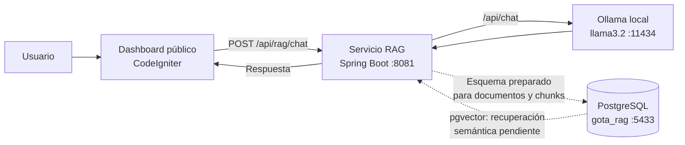

# GOTA RAG service

Spring Boot service for the public GOTA chatbot. It is intentionally isolated
from the CodeIgniter/MySQL monolith and is designed to use a separate
PostgreSQL database with `pgvector`.

## Diagrama de la arquitectura RAG

La integración actual funciona de la siguiente manera:



### Estado actual del flujo

1. El usuario escribe una pregunta en el widget del dashboard.
2. El dashboard envía la pregunta al endpoint `POST /api/rag/chat` de Spring Boot.
3. Spring Boot construye el prompt y lo envía a Ollama.
4. Ollama genera la respuesta usando el modelo local `llama3.2`.
5. Spring Boot devuelve la respuesta al dashboard.
6. PostgreSQL contiene el esquema inicial para documentos y fragmentos, pero la
   ingesta de documentos, los embeddings y la recuperación mediante `pgvector`
   todavía deben conectarse al flujo de conversación.

Por tanto, la implementación actual corresponde a:

```text
Pregunta → Spring Boot → Ollama/llama3.2 → Respuesta
```

El flujo RAG completo que se habilitará posteriormente será:

```text
Documentos → Fragmentos → Embeddings → pgvector
                                      ↓
Pregunta → Búsqueda semántica → Contexto → Ollama → Respuesta fundamentada
```

## Requirements

- Java 21
- Maven 3.9+
- PostgreSQL with the `vector` extension
- Ollama installed and running locally
- The `llama3.2` model downloaded

## Run locally

1. Create a database named `gota_rag` and enable `pgvector`.
2. Confirm Ollama is running and the model is available:

```bash
ollama list
ollama run llama3.2
```

3. Set the database variables from `.env.example`.
4. Start the service:

```bash
mvn spring-boot:run
```

Flyway creates the RAG tables on startup. The service listens on
`http://localhost:8081` by default.

## API

`POST /api/rag/chat` is the internal contract that the Next.js BFF will call.
The Ollama adapter is located in
`src/main/java/com/gota/rag/infrastructure/ollama/OllamaClient.java`; it calls
Ollama's local `/api/chat` endpoint. No LLM API key is required.

```json
{
  "message": "¿Cómo puedo reportar una fuga?",
  "conversationId": "optional-client-conversation-id"
}
```

The current endpoint calls Ollama directly with the user prompt. It is not yet
the complete RAG flow: pgvector retrieval and embeddings still need to be
connected before enabling production answers. Until then, do not treat the
response as grounded in GOTA documents.

Health check: `GET /actuator/health`.
