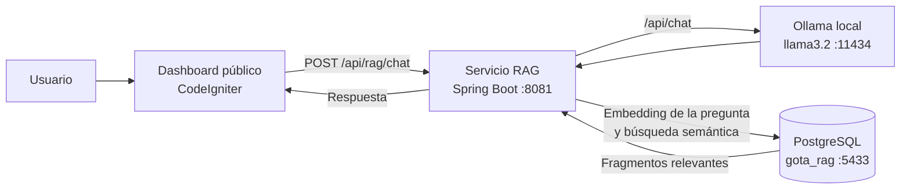

# Servicio RAG de GOTA

Servicio Spring Boot para el chatbot público de GOTA. Está aislado
intencionalmente del monolito de CodeIgniter/MySQL y utiliza una base de datos
PostgreSQL independiente con `pgvector`.

## Diagrama de la arquitectura RAG

La integración actual funciona de la siguiente manera:



### Estado actual del flujo

1. El usuario escribe una pregunta en el widget del dashboard.
2. El dashboard envía la pregunta al endpoint `POST /api/rag/chat` de Spring Boot.
3. Spring Boot construye el prompt y lo envía a Ollama.
4. Ollama genera la respuesta usando el modelo local `llama3.2`.
5. Spring Boot devuelve la respuesta al dashboard.
6. Spring Boot genera el embedding de la pregunta y consulta los fragmentos
   relevantes almacenados en PostgreSQL mediante `pgvector`.
7. Los fragmentos recuperados se agregan al prompt antes de enviarlo a Ollama.

Por tanto, la implementación actual corresponde a:

```text
Pregunta → Embedding → pgvector → Contexto → Ollama/llama3.2 → Respuesta
```

El flujo RAG completo que se habilitará posteriormente será:

```text
Documentos → Fragmentos → Embeddings → pgvector
                                      ↓
Pregunta → Búsqueda semántica → Contexto → Ollama → Respuesta fundamentada
```

## Requisitos

- Java 21
- Maven 3.9+
- PostgreSQL con la extensión `vector`
- Ollama instalado y ejecutándose localmente
- Modelo `llama3.2` descargado
- Modelo de embeddings `nomic-embed-text` descargado

## Ejecución local

1. Crea una base de datos llamada `gota_rag` y habilita `pgvector`.
2. Confirma que Ollama está ejecutándose y descarga los modelos necesarios:

```bash
ollama list
ollama pull nomic-embed-text
ollama run llama3.2
```

3. Configura las variables de la base de datos tomando como referencia
   `.env.example`.
4. Inicia el servicio:

```bash
mvn spring-boot:run
```

Flyway crea las tablas del RAG al iniciar. De forma predeterminada, el
servicio queda disponible en `http://localhost:8081`.

## API

`POST /api/rag/chat` es el contrato interno que utilizará el BFF de Next.js.
El adaptador de Ollama se encuentra en
`src/main/java/com/gota/rag/infrastructure/ollama/OllamaClient.java` y utiliza
el endpoint local `/api/chat` de Ollama. No se necesita una clave de API del
LLM.

```json
{
  "message": "¿Cómo puedo reportar una fuga?",
  "conversationId": "optional-client-conversation-id"
}
```

El endpoint genera un embedding de la pregunta, recupera hasta cinco fragmentos
similares desde `pgvector` y envía ese contexto a Ollama. Si no hay fragmentos
relevantes, el asistente debe indicar que no puede confirmar la respuesta.

El RAG documental no consulta automáticamente las tablas operativas de MySQL.
Por eso preguntas como “¿cuántos clientes activos tenemos?” requieren una
integración adicional con consultas controladas sobre la base de datos del
monolito; no deben resolverse mediante SQL generado por el modelo.

Comprobación de estado: `GET /actuator/health`.

## Consultas operativas controladas

El servicio mantiene una conexión separada a MySQL para responder algunas
métricas públicas en tiempo real. Por seguridad, estas métricas usan consultas
fijas definidas en Java; el modelo no genera SQL.

Actualmente está disponible:

- `¿Cuántos clientes activos tenemos?`: consulta `Clientes.activo = 1`.

Configura la conexión con `OPERATIONAL_DATABASE_URL`,
`OPERATIONAL_DATABASE_USERNAME` y `OPERATIONAL_DATABASE_PASSWORD`. La cuenta
debe tener únicamente los permisos necesarios para leer las tablas requeridas.

## Ingesta de documentos

La ingesta guarda el documento original, lo divide en fragmentos y genera un
embedding para cada fragmento mediante `nomic-embed-text`.

El endpoint está pensado para uso administrativo controlado durante esta etapa:

`POST /api/rag/documents`

Ejemplo:

```json
{
  "title": "Procedimiento para reportar fugas",
  "source": "manual-atencion-ciudadana.md",
  "content": "Para reportar una fuga, comuníquese con los canales oficiales..."
}
```

La respuesta contiene el identificador del documento almacenado:

```json
{
  "documentId": "00000000-0000-0000-0000-000000000000"
}
```

La recuperación de fragmentos mediante `pgvector` todavía debe conectarse al
endpoint de chat. Hasta completar esa etapa, la ingesta no modifica el
comportamiento de las respuestas.
